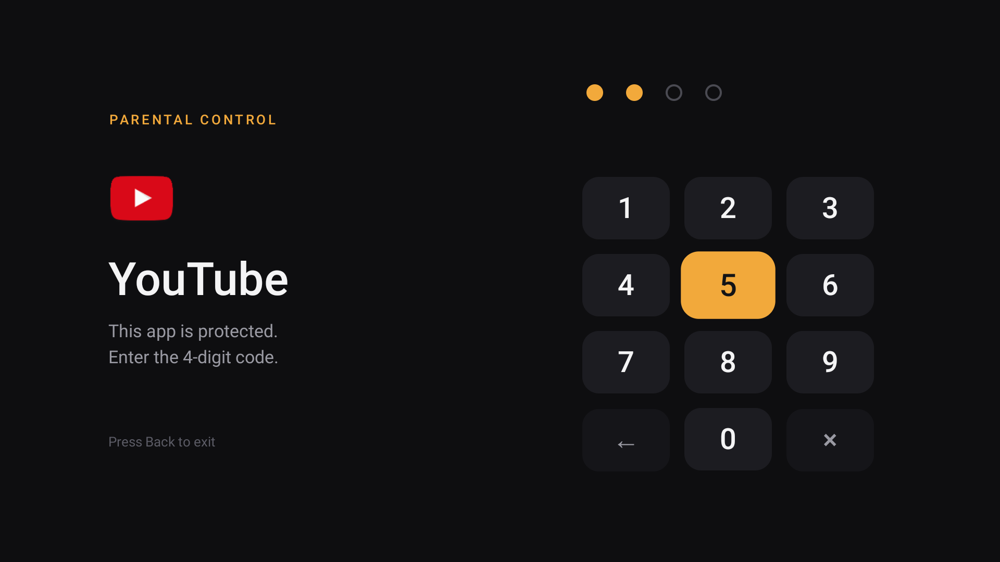

# ShieldLock

**Un code parental à 4 chiffres pour les applis de la NVIDIA Shield et d'Android TV.**

Android TV ne permet pas de mettre un code sur YouTube, Netflix ou le Play Store.
ShieldLock le fait : choisissez les applis à protéger, elles demanderont le code à chaque ouverture.
Pensée pour la télécommande, elle fonctionne hors ligne, sans pub, sans pistage et sans accès à Internet.

[English version](README.md)

<p align="center">
  
</p>

## Fonctions

- **Verrou par appli** avec un code à 4 chiffres, saisi avec les flèches de la télécommande ou les touches chiffres.
- **Assistant au premier lancement** : choix du code, choix des applis, activation du service.
- **Pré-sélection automatique** : environ 75 applis connues de streaming, IPTV, navigateurs, magasins et sideload sont cochées d'office (YouTube, Netflix, Disney+, Prime Video, Crunchyroll, Twitch, Plex, Kodi…), ainsi que les Paramètres et l'installateur d'applis de l'appareil.
- **Anti-contournement** : les Paramètres peuvent être verrouillés pour qu'on ne puisse pas couper le service ; verrouiller le Play Store et l'installateur empêche d'installer de nouvelles applis.
- **Reverrouillage automatique** au retour à l'accueil, à l'ouverture d'une autre appli ou à la mise en veille.
- **Anti-essais en série** : après 5 mauvais codes, la saisie est bloquée 30 s (jusqu'à 10 min).
- **Réglages protégés par le même code** : verrouiller ou libérer chaque appli installée, changer le code.
- En français et en anglais.

## Compatibilité

- NVIDIA Shield TV (2015, 2017, 2019 tube et Pro), Android TV 8.0 ou plus récent.
- Devrait fonctionner sur les autres boîtiers Android TV / Google TV (Chromecast avec Google TV, Mi Box, Sony, Philips…).
  Les retours sont bienvenus dans les issues.

## Installation

Deux méthodes : **uniquement sur la TV** avec l'appli Downloader (la plus simple, sans mode développeur),
ou **depuis un ordinateur** avec un script.

### Option 1 : sur la TV avec Downloader (sans ordinateur, sans mode développeur)

Fonctionne sur toutes les NVIDIA Shield. Environ 2 minutes.

1. Sur la TV, installez **Downloader** (de AFTVnews) depuis le Play Store.
2. Ouvrez Downloader, sélectionnez le champ d'adresse et tapez :

   ```
   github.com/pattex67/ShieldLock/releases/latest/download/ShieldLock.apk
   ```

   Ce lien pointe toujours vers la dernière version.
3. Sélectionnez **Go**. À la fin du téléchargement, sélectionnez **Installer**.
   La première fois, Android demande d'autoriser Downloader à installer des applis inconnues : ouvrez les paramètres proposés,
   activez Downloader, puis revenez et sélectionnez à nouveau **Installer**.
4. Ouvrez **ShieldLock** (dans vos applis) et suivez l'assistant : choix du code, puis des applis à verrouiller.
5. À l'étape 3 de l'assistant, sélectionnez **Ouvrir l'accessibilité**, choisissez **ShieldLock** et activez-le
   (**Paramètres › Préférences de l'appareil › Accessibilité** sur Shield, **Paramètres › Système › Accessibilité** sur Google TV).
   Faites Retour : l'assistant affiche *Service actif*.
6. Vous pouvez supprimer l'APK quand Downloader le propose.

> Sur certains boîtiers Google TV récents (Android 13 et plus), l'interrupteur ShieldLock peut être grisé dans l'Accessibilité
> pour une appli installée hors Play Store. Dans ce cas, utilisez l'option 2.

### Option 2 : depuis un ordinateur

Le script installe l'appli **et** active le service d'accessibilité : plus besoin de l'étape 5 ci-dessus, et ça contourne
l'interrupteur grisé.

1. **Sur la TV**, activez le débogage :
   - **Paramètres › Préférences de l'appareil › À propos**, puis cliquez 7 fois sur **Build** pour débloquer les options pour les développeurs.
   - **Paramètres › Préférences de l'appareil › Options pour les développeurs**, activez **Débogage réseau** (ou débogage USB).
   - Notez l'**adresse IP** de la TV (affichée sous Débogage réseau, ou dans **Paramètres › Réseau**). Elle ressemble à `192.168.x.x`.
2. Depuis la [dernière release](../../releases/latest), téléchargez **`ShieldLock.apk`** et le script d'installation de votre système
   (**`install.ps1`** pour Windows, **`install.sh`** pour macOS / Linux). Mettez-les **dans le même dossier**.
3. Ouvrez un terminal **dans ce dossier** et lancez le script en remplaçant `192.168.x.x` par **l'adresse IP de votre TV** :

   **Windows** (PowerShell) :
   ```powershell
   powershell -ExecutionPolicy Bypass -File .\install.ps1 -Ip 192.168.x.x
   ```
   **macOS / Linux** :
   ```bash
   bash install.sh 192.168.x.x
   ```

   Si `adb` n'est pas présent sur l'ordinateur, le script propose de télécharger les
   [platform-tools](https://developer.android.com/tools/releases/platform-tools) officiels de Google (environ 7 Mo) dans un dossier
   `platform-tools` à côté de lui. Rien n'est installé dans le système : supprimez ce dossier pour l'enlever.

   La première fois, la TV affiche *Autoriser le débogage USB ?* : acceptez, puis relancez la commande si besoin.
4. L'assistant s'ouvre sur la TV : choisissez le code et les applis. Vous pouvez ensuite désactiver le débogage réseau.

> `-ExecutionPolicy Bypass` ne s'applique qu'à cette commande : Windows bloque par défaut les scripts téléchargés.

Depuis un clone de ce dépôt, les scripts sont dans `scripts/` et trouvent l'APK dans `build/` après une compilation.

### Mise à jour

Installez le nouvel APK par-dessus l'ancien, de la même façon. Le code, la liste des applis et le service sont conservés.

## Fonctionnement

ShieldLock est un [service d'accessibilité](https://developer.android.com/guide/topics/ui/accessibility/service) :
il est prévenu quand une appli passe au premier plan et, si elle est verrouillée, affiche l'écran du code par-dessus.
Le bon code déverrouille cette appli jusqu'à ce qu'on la quitte. Le code est stocké sous forme d'empreinte SHA-256 salée, uniquement sur l'appareil.

L'appli ne demande pas l'accès à Internet et n'envoie rien nulle part.

## Limites

ShieldLock est un garde-fou pour les enfants, pas un produit de sécurité :

- Quelqu'un qui a un **accès ADB** peut le désactiver. Coupez le débogage réseau/USB après l'installation.
- Si les **Paramètres** ne sont pas verrouillés, on peut y couper le service ou désinstaller l'appli.
- Les applis installées **après** la configuration ne sont pas verrouillées d'office : cochez-les dans les réglages de ShieldLock
  (verrouiller le Play Store et l'installateur empêche les autres d'installer des applis).
- Les aperçus vidéo lancés automatiquement sur l'écran d'accueil ne sont pas bloqués, seules les applis le sont.

## Compiler

Voir la section [Build from source](README.md#build-from-source) du README anglais.

## Licence

[MIT](LICENSE).

ShieldLock est un projet indépendant, sans lien avec NVIDIA ou Google.
NVIDIA et SHIELD sont des marques de NVIDIA Corporation ; Android TV est une marque de Google LLC.
