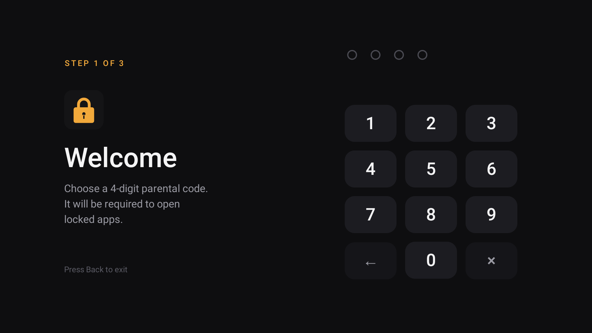
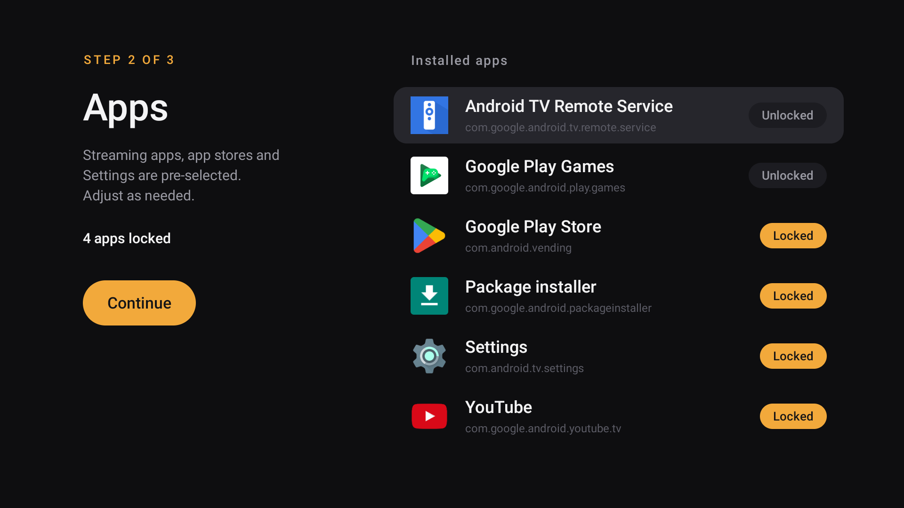
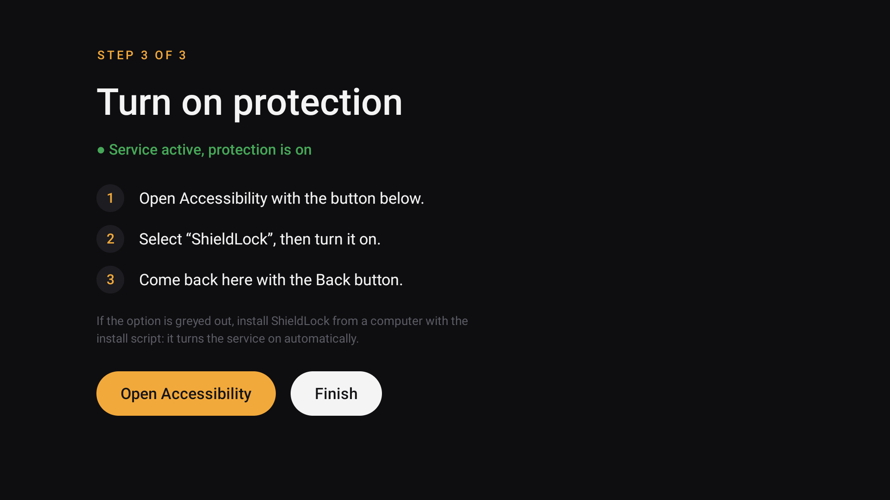
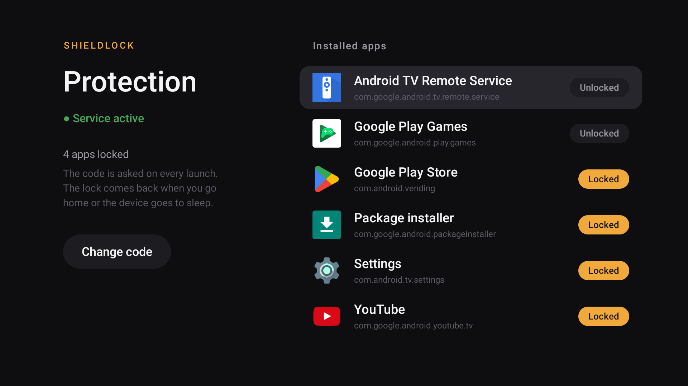

# ShieldLock

**A 4-digit parental PIN for apps on NVIDIA Shield and Android TV.**

Android TV has no built-in way to put a code on YouTube, Netflix or the Play Store.
ShieldLock adds one: pick the apps to protect, and they ask for the code every time they are opened.
It is designed for the remote control (D-pad), works offline and has no ads, no tracking and no internet permission.

[Version française](README.fr.md)

<p align="center">
  
</p>

## Features

- **Per-app lock** with a 4-digit code, entered with the remote's arrows or number keys.
- **Setup wizard** on first launch: choose the code, review the app list, turn the service on.
- **Smart pre-selection**: about 75 known streaming, IPTV, browser, store and sideloading apps are checked by default (YouTube, Netflix, Disney+, Prime Video, Crunchyroll, Twitch, Plex, Kodi…), plus the device's own Settings and package installer.
- **Anti-bypass**: Settings can be locked so the service can't be turned off; locking the Play Store and the package installer blocks new installs.
- **Relocks automatically** when you go back home, open another app, or the device goes to sleep / screensaver.
- **Brute-force protection**: after 5 wrong codes, input is blocked for 30 s (growing up to 10 min).
- **Settings protected by the same code**: lock or unlock any installed app, change the code.
- English and French.

| Setup: code | Setup: apps | Setup: activation | Settings |
|---|---|---|---|
|  |  |  |  |

## Compatibility

- NVIDIA Shield TV (2015, 2017, 2019 tube and Pro), Android TV 8.0 or later.
- Should work on other Android TV / Google TV devices (Chromecast with Google TV, Mi Box, Sony, Philips…).
  Reports are welcome in the issues.

## Install

### Option 1: from a computer (recommended)

This also turns the accessibility service on, which some devices don't allow from the TV for sideloaded apps.

1. **On the TV**, enable debugging:
   - **Settings › Device preferences › About**, then click **Build** 7 times to unlock developer options.
   - **Settings › Device preferences › Developer options**, turn on **Network debugging** (or USB debugging).
   - Note the TV's **IP address** (shown under Network debugging, or in **Settings › Network**). It looks like `192.168.x.x`.
2. From the [latest release](../../releases/latest), download **`ShieldLock-x.y.z.apk`** and the install script for your system
   (**`install.ps1`** for Windows, **`install.sh`** for macOS / Linux). Put them **in the same folder**.
3. Open a terminal **in that folder** and run the script, replacing `192.168.x.x` with **your TV's IP address**:

   **Windows** (PowerShell):
   ```powershell
   powershell -ExecutionPolicy Bypass -File .\install.ps1 -Ip 192.168.x.x
   ```
   **macOS / Linux**:
   ```bash
   bash install.sh 192.168.x.x
   ```

   If `adb` isn't on the computer, the script offers to download Google's official
   [platform-tools](https://developer.android.com/tools/releases/platform-tools) (about 7 MB) into a `platform-tools`
   folder next to it. Nothing is installed system-wide: delete that folder to remove it.

   The first time, the TV shows an *Allow USB debugging?* prompt: accept it, then run the command again if needed.
4. The setup wizard opens on the TV: choose the code and the apps. You can then turn network debugging off.

> `-ExecutionPolicy Bypass` only applies to this command: Windows blocks downloaded scripts by default.

When working from a clone of this repository, the scripts are in `scripts/` and find the APK in `build/` after a build.

### Option 2: on the TV only

Sideload the APK (for example with the *Downloader* app), open **ShieldLock** and follow the wizard.
At step 3, enable **ShieldLock** in **Settings › Device preferences › Accessibility**.

## How it works

ShieldLock is an [accessibility service](https://developer.android.com/guide/topics/ui/accessibility/service):
it is notified when an app comes to the foreground, and if that app is locked it shows the PIN screen on top.
A correct code unlocks that app until you leave it. The code is stored as a salted SHA-256 hash, on the device only.

The app requests no internet permission and sends nothing anywhere.

## Limitations

ShieldLock is a deterrent for kids, not a security product. Be aware that:

- Anyone with **ADB access** can disable it. Turn network/USB debugging off once set up.
- If **Settings** is not locked, the service can be turned off or the app uninstalled from there.
- Apps installed **after** setup are not locked automatically: lock them from ShieldLock's settings
  (locking the Play Store and the package installer prevents others from installing apps).
- Video previews that auto-play on the home screen are not blocked, only apps are.

## Build from source

No Gradle needed, only the Android SDK (build-tools and one platform) and a JDK 11+
(the one bundled with Android Studio works).

```powershell
.\scripts\build.ps1        # Windows
```
```bash
./scripts/build.sh         # macOS / Linux
```

The APK is written to `build/ShieldLock-<version>.apk`. Without configuration it is signed with your Android debug key.
To sign with your own key, create a `signing.properties` file at the repo root (it is git-ignored):

```properties
storeFile=/path/to/release.jks
storePassword=...
keyAlias=...
keyPassword=...
```

### Adding apps to the pre-selection

The list lives in `SUGGESTED` in [`src/app/shieldlock/LockConfig.java`](src/app/shieldlock/LockConfig.java).
Pull requests adding package names are welcome.

## License

[MIT](LICENSE).

ShieldLock is an independent project, not affiliated with or endorsed by NVIDIA or Google.
NVIDIA and SHIELD are trademarks of NVIDIA Corporation; Android TV is a trademark of Google LLC.
